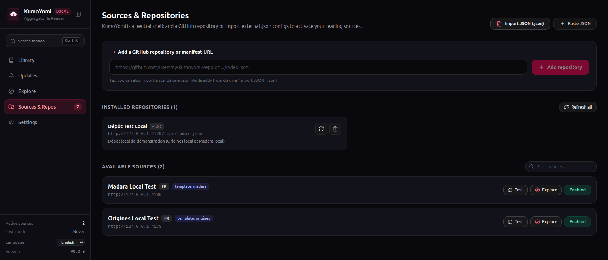
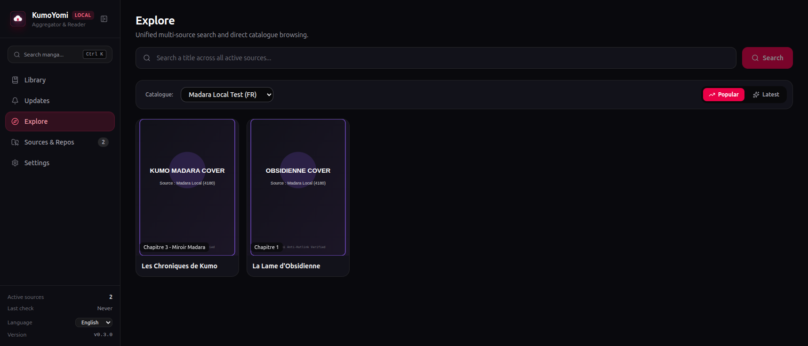
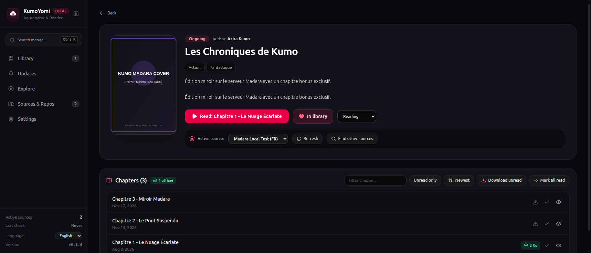
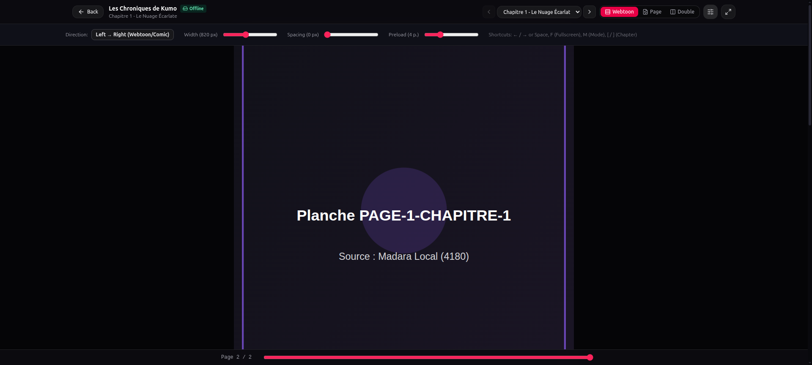
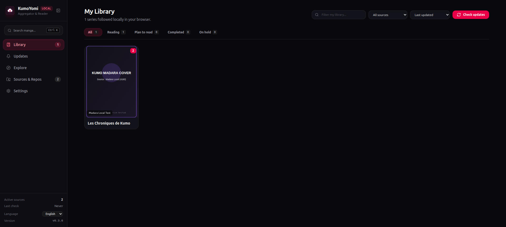
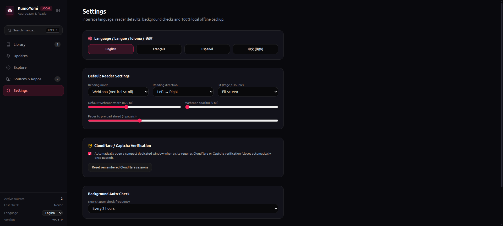

# KumoYomi

**100% local, privacy-first manga aggregator and reader for desktop browsers (Firefox, Chrome, Brave, Edge).**

KumoYomi runs entirely inside your browser as a full-tab MV3 extension (`app.html`). It acts as a **neutral reader shell** with zero hardcoded websites, zero accounts, zero tracking servers, and zero cloud sync:

- Your **library, reading history, and offline chapters** are stored locally in IndexedDB (Dexie).
- Reading sources are loaded externally via JSON configurations from third-party source repositories such as [`KumoYomi-Sources/extensions-source`](https://github.com/KumoYomi-Sources/extensions-source).
- Built-in **4-language UI**: English (`en`), Français (`fr`), Español (`es`), and 中文 (`zh`), auto-detected from your browser locale and switchable at any time.

---

## Table of Contents

- [Core Features](#core-features)
- [Getting Started (Visual Guide)](#getting-started-visual-guide)
- [Installation](#installation)
- [Adding & Creating Sources (Human or AI)](#adding--creating-sources-human-or-ai)
- [Project Architecture & Hierarchy](#project-architecture--hierarchy)
- [Development & Build](#development--build)
- [Contributing & Roadmap](#contributing--roadmap)

---

## Core Features

- **Neutral JSON Parser Engine (`src/core/parser/`)**: Parses HTML (`DOMParser`), REST JSON APIs, `json-html` endpoints, and inline `<script>` JSON hydration payloads (`__NEXT_DATA__`, `ts_reader.run`) without eval or remote executable code. Supports reusable inheritance templates (`origines`, `madara`, `mangathemesia`).
- **Interactive Source Inspector**: Test Catalogue (`Popular`/`Latest`/`Search`), Manga Details, Chapters, and Chapter Pages (with live anti-hotlink Preview & latency readout) right inside **Sources & Repos**.
- **Library, Custom Categories & Local Stats**: Track reading statuses (`Reading`, `Plan to read`, `Completed`, `On hold`, `Dropped`), organize with custom user-defined categories, filter by source/category/unread counts, view local reading statistics in **Updates & History**, batch-mark chapters read/unread, and merge series across sources.
- **Full-Screen Reader**:
  - **Webtoon** (vertical continuous scroll with configurable width and gap), **Single Page**, and **Double Page** (open-book spread) modes.
  - **Left-to-Right** and **Right-to-Left (Manga)** reading directions.
  - Fit presets (`Fit screen`, `Full width`, `Original size`), configurable ahead-of-time page preloading (`0–15` pages), skeleton loading animations, and an in-reader **Keyboard Shortcuts Help modal (`?`)** (`←` / `→`, `Space`, `F`, `M`, `[` / `]`, `?`, `Esc`).
- **100% Offline Chapter Storage & Auto-Cleanup**: Download single or unread chapters into IndexedDB for offline reading, with optional automatic removal once chapters are marked read.
- **Background Checks & Desktop Notifications**: Scheduled update checks paced per domain with toolbar badge updates and optional local desktop notifications (`browser.notifications`).
- **Anti-Hotlink & Cloudflare Session Assist**: Injects compliant per-domain `Referer`/`Origin` headers via MV3 `declarativeNetRequest`, keeps a single deduplicated pinned session tab alive for cleared domains (and automatically wakes sleeping tabs), and notifies UI banners immediately once unlocked.
- **Portable Local Backups & Zero Telemetry**: Export/restore full library, sources, and history as `.json`, backed by our zero-collection policy in [PRIVACY.md](PRIVACY.md).

---

## Getting Started (Visual Guide)

### 1. Load an External Source Repository
KumoYomi starts completely empty. Open **Sources & Repos** from the sidebar and add a repository URL (for instance, `https://github.com/KumoYomi-Sources/extensions-source`) or import a standalone `.json` config.



### 2. Browse Catalogues & Multi-Source Search
Switch to **Explore** to browse `Popular` / `Latest` catalogues per source or run a unified keyword search across every enabled source in parallel (`Ctrl + K` works from anywhere).



### 3. Manage Series Details & Offline Downloads
Open any title to view metadata, genres, publication status, alternative sources (**Find other sources**), and chapter lists. Click **Add to library** and download individual or unread chapters for offline reading.



### 4. Customize the Full-Screen Reader
Launch any chapter to read in **Webtoon**, **Single Page**, or **Double Page** mode. Expand **Reader options** in the top bar to adjust reading direction, page width, vertical spacing, or page preload buffer.



### 5. Track Your Library & Check Updates
Filter your library by status (`All`, `Reading`, `Plan to read`, `Completed`, `On hold`), check for new chapters across all followed series on demand or in the background, and jump right back in.



### 6. Configure Languages, Verification & Backups
Visit **Settings** to switch between **English**, **Français**, **Español**, and **中文 (简体)**, set global reader defaults, manage Cloudflare popup verification, and export/import local IndexedDB backups.



---

## Installation

Pre-built extension archives are published on the [**GitHub Releases**](../../releases) page via [`release.yml`](.github/workflows/release.yml).

### Firefox (Recommended Focus)

1. **Temporary install (testing / development)**:
   - Build locally (`pnpm build:firefox`) or download & extract the Firefox release archive.
   - Open `about:debugging#/runtime/this-firefox`.
   - Click **Load Temporary Add-on…** and select `.output/firefox-mv3/manifest.json` (or the downloaded `.zip`).
   - *Note: Firefox Release removes temporary add-ons on browser restart; use Firefox Developer Edition/Nightly (`xpinstall.signatures.required = false`) or signed AMO `.xpi` packages for persistent installs.*
2. **Signed distribution via Firefox Add-ons (AMO)**:
   - Use `pnpm build:firefox:amo` (`KUMOYOMI_AMO_LISTED=1`) or `kumoyomi-<version>-firefox-amo-listed.zip` from GitHub Releases for strict `optional_host_permissions` compliance, alongside [PRIVACY.md](PRIVACY.md) and [CONTRIBUTING.md](CONTRIBUTING.md). See [docs/ROADMAP.md](docs/ROADMAP.md#1-firefox-amo-store-readiness).

### Chrome / Brave / Edge

1. Download and unzip `kumoyomi-<version>-chrome.zip` (or build locally with `pnpm build` -> `.output/chrome-mv3`).
2. Open `chrome://extensions` and enable **Developer mode**.
3. Click **Load unpacked** and select the extracted folder.

---

## Adding & Creating Sources (Human or AI)

KumoYomi never hardcodes reading websites. All site definitions live in external JSON files — see the official community repository [`KumoYomi-Sources/extensions-source`](https://github.com/KumoYomi-Sources/extensions-source) or create your own repository.

Read the complete specification in [**docs/ADDING_SOURCES.md**](docs/ADDING_SOURCES.md).

### Quick Feasibility Matrix

| Site Type | Difficulty | Notes |
| --- | --- | --- |
| Standard themes (`origines`, `madara`, `mangathemesia`) | **Easy** | Extend `_templates/<theme>.json` — often 10–30 lines of JSON. |
| Clean SSR HTML or open REST/JSON APIs | **Easy / Medium** | Use CSS `FieldExtractor` selectors, `responseType: "json"`/`"json-html"`, or `numberedPages`. |
| `<script>` JSON hydration (`__NEXT_DATA__`, `ts_reader.run`) | **Easy / Medium** | Use `responseType: "json"` with `request.scriptJson` (`selector` / `regex`). |
| Sites behind Cloudflare / Hotlink protection | **Supported** | Works with `headers`, `warmupUrl`, MV3 DNR `Referer` injection, and user-cleared Cloudflare popup/tab proxy. |
| Canvas image descrambling, AES/HMAC per-request payload signing, or multi-step login tokens | **Hard / Unsupported** | Requires core parser extensions tracked in [docs/ROADMAP.md](docs/ROADMAP.md). |

### Use an AI Coding Assistant to Add a Source

You can ask an AI agent (with access to `curl`, DevTools, or a browser) to analyze a target manga site and generate a working KumoYomi JSON config + PR for [`KumoYomi-Sources/extensions-source`](https://github.com/KumoYomi-Sources/extensions-source). A ready-to-copy prompt and full schema checklist are included in [**docs/ADDING_SOURCES.md#ai-assisted-source-authoring**](docs/ADDING_SOURCES.md#ai-assisted-source-authoring).

---

## Project Architecture & Hierarchy

```text
KumoYomi/
├── entrypoints/
│   ├── app/                  # Full-tab React entry point (index.html, main.tsx, style.css)
│   └── background.ts         # MV3 service worker (action tab, update alarm, DNR & tab proxy routing)
├── public/icon/              # Extension icons (16, 32, 48, 128 px)
├── src/
│   ├── app/                  # App router (hash routes) & persistent sidebar layout (AppShell.tsx)
│   ├── features/             # Domain pages:
│   │   ├── library/          # Followed series, reading status tabs, local search & sorting
│   │   ├── updates/          # Recent chapter feed across followed manga
│   │   ├── explore/          # Parallel multi-source search & source catalogue browsing
│   │   ├── manga-detail/     # Metadata, source switcher/migrator & chapter offline management
│   │   ├── reader/           # Webtoon / Single / Double reader, preloader & keyboard shortcuts
│   │   ├── sources/          # Repo sync, JSON import/paste & connection tester
│   │   └── settings/         # Language selector, reader defaults, CF popup & JSON backup
│   ├── components/           # Shared UI (AntiHotlinkImage, CloudflareBanner, UpdateCheckStatusBanner)
│   └── core/                 # Browser-agnostic business & storage engine:
│       ├── db/               # Dexie IndexedDB schema, reactive repository & JSON backup/restore
│       ├── extension/        # MV3 bridges: DNR Referer rules, tab proxy, Cloudflare popup verification
│       ├── i18n/             # Strongly-typed 4-language dictionaries (en, fr, es, zh)
│       ├── image-loader/     # Priority fetch queue, hotlink bypass & IndexedDB cover/page blob cache
│       ├── offline/          # Batch chapter downloader & storage cleaner
│       ├── parser/           # Universal JSON/HTML parser, validator, date/chapter parsers & repo sync
│       ├── types/            # Shared TypeScript contracts (SourceConfig, MangaEntity, AppSettings)
│       └── updater/          # Background & manual favorite chapter update checker
├── tools/
│   ├── generate-icons.mjs    # PNG icon generator
│   ├── mock-manga-servers.mjs# Local copyright-free Origines & Madara mock servers for testing/screenshots
│   └── mihon-converter/      # Helper CLI converting simple Mihon theme extensions to JSON templates
├── tests/                    # Vitest suite & JSON/template fixtures
└── docs/                     # Source authoring guide, roadmap & UI screenshots
```

---

## Development & Build

**Prerequisites:** Node.js `>= 22`, `pnpm` (`>= 10` / `pnpm@11.15.1` via Corepack).

```bash
# Install dependencies
pnpm install

# Type-check and run unit tests (Vitest + jsdom + fake-indexeddb)
pnpm typecheck
pnpm test

# Run live UI preview against mock servers (no browser extension install needed for layout tests)
node tools/mock-manga-servers.mjs --no-hotlink
pnpm preview:web

# Build browser bundles
pnpm build:firefox     # -> .output/firefox-mv3
pnpm build:firefox:amo # -> .output/firefox-mv3 (optional_host_permissions for AMO Listed)
pnpm build             # -> .output/chrome-mv3
pnpm zip               # -> .output/*.zip (Chrome & Firefox)
```

---

## Contributing & Roadmap

- **Extension bugs, UI, i18n, and core engine PRs**: Read [CONTRIBUTING.md](CONTRIBUTING.md).
- **Adding or fixing manga website JSON configs**: Submit a Pull Request to [`KumoYomi-Sources/extensions-source`](https://github.com/KumoYomi-Sources/extensions-source) following [docs/ADDING_SOURCES.md](docs/ADDING_SOURCES.md).
- **Planned features & store readiness status**: Check [docs/ROADMAP.md](docs/ROADMAP.md).
